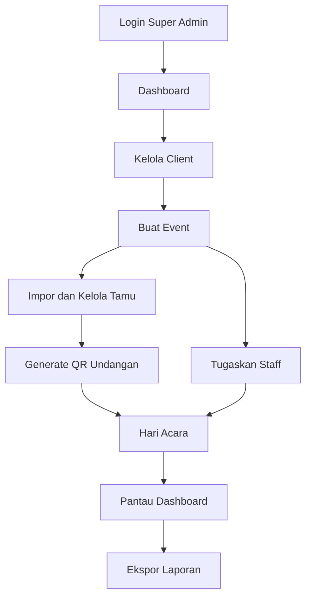
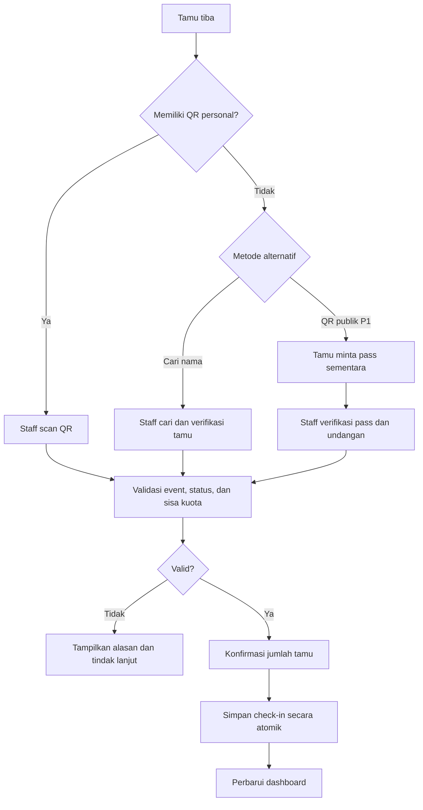

# Product Requirements Document (PRD)

# WedFlow — Smart Wedding Guest Management & Check-in

| Informasi | Detail |
|---|---|
| Produk | WedFlow |
| Jenis | Platform web manajemen tamu dan check-in pernikahan |
| Model bisnis | Managed service / penyedia jasa untuk banyak klien |
| Versi dokumen | 1.0 |
| Tanggal | 24 Oktober 2026 |
| Status | Draft perencanaan; status implementasi perlu diverifikasi di repository |
| Platform | Web responsif (desktop, tablet, mobile) |

## 1. Ringkasan Eksekutif

**WedFlow** adalah platform manajemen tamu pernikahan yang digunakan penyedia jasa untuk mengelola banyak klien (pasangan pengantin atau wedding organizer), acara, undangan, petugas, proses check-in, dan laporan kehadiran dalam satu sistem. Fokus utamanya adalah mempercepat proses penerimaan tamu, terutama ketika tamu lupa atau tidak dapat menunjukkan QR undangan.

WedFlow mengutamakan tiga jalur kedatangan: **scan QR personal**, **pencarian nama dengan verifikasi petugas**, serta **QR publik untuk pre-check-in** yang menghasilkan pass sementara dan tetap memerlukan validasi petugas.

## 2. Latar Belakang dan Permasalahan

- Check-in manual menggunakan buku tamu lambat dan menyulitkan rekap kehadiran.
- QR undangan dapat terlupa, hilang, atau sulit diakses ketika koneksi internet buruk.
- Pencarian daftar tamu secara manual memperpanjang antrean.
- Kuota undangan keluarga/rombongan sering tidak tercatat secara akurat.
- Wedding organizer membutuhkan data kehadiran dan laporan yang bisa dipantau selama acara.
- Penyedia jasa perlu memisahkan data antar-klien dan mengatur hak akses staf.

## 3. Visi, Tujuan, dan Ukuran Keberhasilan

### 3.1 Visi

Menjadi solusi check-in pernikahan yang cepat, fleksibel, aman, dan mudah dioperasikan oleh petugas di lokasi acara.

### 3.2 Tujuan Produk

1. Memungkinkan satu penyedia jasa mengelola banyak klien dan event secara terpusat.
2. Memberikan alternatif check-in ketika QR personal tidak tersedia.
3. Mengurangi risiko check-in ganda dan penyalahgunaan kuota undangan.
4. Memberikan informasi kehadiran secara real-time kepada pihak berwenang.
5. Mempermudah impor data tamu dan ekspor laporan setelah acara.

### 3.3 KPI Awal (Target untuk Diuji)

| Metrik | Target awal | Metode ukur |
|---|---|---|
| Waktu check-in QR personal | Median ≤ 10 detik | Timestamp scan sampai konfirmasi |
| Waktu check-in melalui nama | Median ≤ 30 detik | Timestamp pencarian sampai konfirmasi |
| Check-in ganda yang diterima | 0 | Audit transaksi dan pengujian konkurensi |
| Keberhasilan impor tamu valid | ≥ 99% | Baris berhasil / baris valid |
| Visibilitas data check-in | Pembaruan ≤ 5 detik pada koneksi normal | Pengujian end-to-end |

> Target di atas adalah hipotesis produk, bukan hasil pengukuran aktual. Evaluasi kembali setelah pilot event.

## 4. Pengguna dan Peran

| Peran | Deskripsi | Akses utama |
|---|---|---|
| **Super Admin** | Pemilik/penyedia jasa WedFlow | Semua klien, event, pengguna, pengaturan, dan laporan |
| **Client** | Pasangan pengantin atau perwakilan WO | Dashboard dan laporan event yang menjadi haknya |
| **Staff** | Petugas penerima tamu | Check-in dan daftar tamu untuk event yang ditugaskan |
| **Guest** | Tamu undangan | Menunjukkan QR atau menggunakan pre-check-in publik tanpa akun |

**Prinsip akses:** semua operasi penting divalidasi di server. Client tidak boleh melihat event milik klien lain; staff hanya boleh mengakses event penugasannya.

## 5. Ruang Lingkup

### 5.1 MVP (Prioritas Rilis Awal)

- Login, logout, dan role-based access control.
- Pengelolaan client dan event.
- Penugasan staff ke event.
- Pengelolaan daftar tamu dan kuota undangan.
- Impor tamu melalui CSV/XLSX dengan validasi dan preview.
- QR unik per undangan.
- Check-in melalui QR personal.
- Check-in melalui pencarian nama dan konfirmasi petugas.
- Pencegahan check-in ganda dan pembatasan kuota.
- Dashboard statistik kehadiran dan ekspor CSV.
- Audit log aktivitas kritis.

### 5.2 Pasca-MVP

- QR publik dan pre-check-in dengan pass sementara.
- Sinkronisasi real-time yang lebih canggih.
- Offline-first dan rekonsiliasi data.
- Template undangan digital dan pengiriman pesan.
- Laporan lanjutan dan paket layanan/booking.
- Multi-gate, manajemen perangkat, dan analitik operasional.

### 5.3 Di Luar Lingkup MVP

- Marketplace vendor pernikahan.
- Payment gateway untuk transaksi tamu.
- Aplikasi native Android/iOS.
- Identifikasi wajah atau biometrik.

## 6. Kebutuhan Fungsional

Prioritas: **P0** wajib untuk MVP, **P1** penting setelah MVP stabil, **P2** pengembangan lanjutan.

| ID | Modul | Kebutuhan | Prioritas |
|---|---|---|---|
| F01 | Authentication | Login email/password, logout, session aman, reset password melalui admin pada MVP | P0 |
| F02 | RBAC | Proteksi route, API, dan data sesuai role serta kepemilikan event | P0 |
| F03 | Client | CRUD client, pencarian, status aktif/nonaktif | P0 |
| F04 | Event | CRUD event, slug unik, tanggal, lokasi, status acara | P0 |
| F05 | Staff | Penugasan dan pencabutan akses staff per event | P0 |
| F06 | Guest | CRUD tamu, undangan individu/keluarga, kuota, pencarian dan filter | P0 |
| F07 | Import | Unggah CSV/XLSX, pemetaan kolom, validasi, preview, laporan error | P0 |
| F08 | QR Personal | Generate QR berisi token/kode opaque unik, bukan data pribadi | P0 |
| F09 | QR Check-in | Scan, tampilkan identitas relevan, validasi kuota, konfirmasi | P0 |
| F10 | Name Lookup | Pencarian nama toleran salah ketik, hasil kandidat, verifikasi staff | P0 |
| F11 | Attendance | Simpan jumlah hadir, waktu, metode, petugas; cegah duplikasi | P0 |
| F12 | Dashboard | Statistik undangan, hadir, belum hadir, dan aktivitas terbaru | P0 |
| F13 | Reporting | Ekspor daftar kehadiran CSV dan jejak audit | P0 |
| F14 | Public QR | QR lokasi untuk memulai pre-check-in tanpa QR personal | P1 |
| F15 | Temporary Pass | Pass bertenggat waktu, sekali pakai, dikonfirmasi staff | P1 |
| F16 | Realtime | Pembaruan statistik dan status antarperangkat secara langsung | P1 |
| F17 | Offline | Antrean transaksi lokal dan rekonsiliasi saat online | P2 |
| F18 | Business | Booking, paket layanan, dan status operasional penyedia jasa | P2 |

## 7. User Stories dan Acceptance Criteria

### US-01 — Admin membuat client

**Sebagai** Super Admin, **saya ingin** menambahkan client agar dapat mengelola acara untuk pelanggan berbeda.

**Kriteria penerimaan:**
- Admin dapat memasukkan nama, kontak, jenis client, dan status.
- Field wajib divalidasi di frontend dan backend.
- Client baru tersimpan di database dan terlihat pada daftar.
- Pengguna tanpa role Super Admin menerima penolakan akses.

### US-02 — Admin membuat event

**Sebagai** Super Admin, **saya ingin** membuat event yang terhubung dengan client.

**Kriteria penerimaan:**
- Event wajib memiliki client, nama, tanggal, dan slug unik.
- Event bisa berada pada status `DRAFT`, `ACTIVE`, `COMPLETED`, atau `CANCELLED`.
- Staff yang belum ditugaskan tidak dapat mengakses data event.

### US-03 — Admin mengimpor daftar tamu

**Sebagai** Super Admin, **saya ingin** mengimpor file tamu agar tidak perlu mengetik satu per satu.

**Kriteria penerimaan:**
- File diperiksa format, ukuran, kolom, dan isi datanya.
- Sistem menyediakan preview sebelum impor permanen.
- Baris bermasalah dilaporkan tanpa membocorkan data ke client lain.
- Data yang sudah diimpor tidak terduplikasi secara tidak sengaja.

### US-04 — Staff melakukan scan QR personal

**Sebagai** Staff, **saya ingin** memindai QR tamu untuk mencatat kehadiran dengan cepat.

**Kriteria penerimaan:**
- QR hanya valid untuk undangan pada event yang sedang ditangani.
- Sistem menampilkan nama dan sisa kuota sebelum konfirmasi.
- Staff dapat memasukkan jumlah anggota rombongan yang hadir.
- Transaksi ditolak jika kuota terlampaui atau QR tidak valid.
- Setiap transaksi tersimpan bersama petugas, waktu, dan metode.

### US-05 — Staff mencari nama ketika QR terlupa

**Sebagai** Staff, **saya ingin** mencari tamu berdasarkan nama agar antrean tetap berjalan ketika QR tidak tersedia.

**Kriteria penerimaan:**
- Pencarian mendukung nama parsial dan toleransi salah ketik.
- Sistem menampilkan beberapa kandidat tanpa memilih otomatis bila ambigu.
- Staff harus memverifikasi kandidat berdasarkan informasi undangan yang relevan.
- Sistem menerapkan aturan kuota dan duplikasi yang sama dengan QR.

### US-06 — Client memantau kehadiran

**Sebagai** Client, **saya ingin** melihat statistik event milik saya.

**Kriteria penerimaan:**
- Client hanya dapat mengakses event yang diberikan kepadanya.
- Statistik memisahkan total undangan, total tamu hadir, dan sisa kuota.
- Laporan dapat diunduh sesuai hak akses.

### US-07 — Tamu melakukan pre-check-in publik (P1)

**Sebagai** Guest, **saya ingin** memindai QR publik untuk mendapatkan pass sementara saat tidak membawa QR personal.

**Kriteria penerimaan:**
- QR publik hanya membuka alur permintaan, bukan langsung menandai hadir.
- Guest memasukkan data minimum untuk pencarian undangan.
- Sistem menghasilkan pass sementara dengan masa berlaku terbatas.
- Staff memverifikasi identitas undangan dan mengonfirmasi kehadiran.
- Pass tidak dapat dipakai ulang setelah berhasil digunakan.
- Sistem menerapkan pembatasan permintaan untuk mencegah penyalahgunaan.

## 8. Alur Utama Pengguna

### 8.1 Alur Admin

### 8.2 Alur Check-in

## 9. Aturan Bisnis

1. **Satu undangan terkait tepat satu event** dan memiliki kode unik yang sulit ditebak.
2. **Kuota undangan** merupakan jumlah maksimum orang yang boleh hadir menggunakan undangan tersebut.
3. Kehadiran dapat dicatat bertahap untuk keluarga/rombongan selama total hadir tidak melebihi kuota.
4. Check-in hanya diizinkan ketika event berstatus `ACTIVE`, kecuali override administratif yang diaudit.
5. **Transaksi check-in harus atomik** agar dua petugas tidak dapat memakai sisa kuota yang sama secara bersamaan.
6. Pencarian nama adalah bantuan menemukan undangan, **bukan bukti identitas otomatis**.
7. QR publik tidak boleh menghasilkan check-in final tanpa verifikasi petugas.
8. Pass sementara memiliki expiry, event scope, status, dan perlindungan replay.
9. Semua tindakan penting menyimpan jejak audit; data sensitif pada log diminimalkan.
10. Data client dan event harus diisolasi pada query dan pemeriksaan izin server.

## 10. Model Data Konseptual

| Entitas | Field penting | Keterangan |
|---|---|---|
| `User` | id, name, email, passwordHash, role | Akun Super Admin, Client, Staff |
| `Client` | id, name, type, email, phone, status | Pelanggan layanan |
| `Event` | id, clientId, name, slug, eventDate, location, status | Acara milik client |
| `EventStaff` | id, eventId, userId, status | Penugasan staff |
| `Invitation` | id, eventId, code, label, guestQuota | Unit undangan/keluarga |
| `Guest` | id, invitationId, name, contact, category | Anggota daftar tamu |
| `CheckIn` | id, invitationId, eventId, staffId, attendeeCount, method, checkedInAt | Transaksi kehadiran |
| `PreCheckInRequest` | id, eventId, invitationId, tokenHash, expiresAt, status | Permintaan pass sementara (P1) |
| `AuditLog` | id, actorId, eventId, action, entityType, entityId, createdAt | Audit aktivitas |
| `Booking` | id, clientId, packageId, status | Operasional jasa (P2) |

> Struktur ini adalah rancangan target. Model yang sudah ada dalam `prisma/schema.prisma` harus diaudit dan dimigrasikan secara bertahap, bukan ditimpa secara membabi buta.

### Relasi inti

- `Client` 1:N `Event`
- `Event` 1:N `Invitation`
- `Invitation` 1:N `Guest`
- `Event` N:M `User` (staff) melalui `EventStaff`
- `Invitation` 1:N `CheckIn`
- `Event` 1:N `CheckIn`

## 11. Rancangan Halaman dan Navigasi

| Route | Role | Fungsi |
|---|---|---|
| `/login` | Publik | Form login |
| `/admin` | Super Admin | Dashboard penyedia jasa |
| `/admin/clients` | Super Admin | Daftar dan CRUD client |
| `/admin/events` | Super Admin | Daftar event |
| `/admin/events/[id]` | Super Admin | Detail dan konfigurasi event |
| `/admin/events/[id]/guests` | Super Admin | Tamu dan undangan |
| `/admin/events/[id]/staff` | Super Admin | Penugasan petugas |
| `/admin/events/[id]/reports` | Super Admin | Statistik dan ekspor |
| `/client` | Client | Dashboard client |
| `/client/events/[id]` | Client terotorisasi | Detail dan laporan event |
| `/staff` | Staff | Daftar event penugasan |
| `/staff/events/[id]/checkin` | Staff terotorisasi | Scanner dan pencarian nama |
| `/e/[slug]/precheckin` | Publik (P1) | Permintaan pre-check-in |

Semua route adalah rancangan; penamaan dapat disesuaikan dengan struktur aplikasi yang telah ada.

## 12. API / Server Actions (Rancangan)

| Metode | Endpoint | Fungsi |
|---|---|---|
| `POST` | `/api/auth/*` | Auth.js authentication |
| `GET/POST` | `/api/clients` | Daftar dan tambah client |
| `GET/PATCH/DELETE` | `/api/clients/:id` | Detail, ubah, nonaktifkan client |
| `GET/POST` | `/api/events` | Daftar dan buat event |
| `GET/PATCH` | `/api/events/:id` | Detail dan ubah event |
| `GET/POST` | `/api/events/:id/staff` | Lihat dan atur penugasan |
| `GET/POST` | `/api/events/:id/invitations` | Daftar dan tambah undangan |
| `POST` | `/api/events/:id/guests/import` | Impor daftar tamu |
| `POST` | `/api/events/:id/checkins` | Konfirmasi check-in |
| `GET` | `/api/events/:id/guests/search` | Pencarian kandidat tamu |
| `GET` | `/api/events/:id/stats` | Statistik kehadiran |
| `GET` | `/api/events/:id/reports/export` | Ekspor laporan |
| `POST` | `/api/public/events/:slug/precheckin` | Permintaan pass (P1) |
| `POST` | `/api/events/:id/precheckin/verify` | Verifikasi pass (P1) |

**Kontrak API:** gunakan Zod untuk validasi request, respons error konsisten, pagination pada koleksi, dan pemeriksaan akses di server. Mutasi check-in perlu idempotency key atau mekanisme setara untuk mengatasi retry.

## 13. Kebutuhan Nonfungsional

### 13.1 Keamanan

- Password di-hash dengan bcryptjs atau algoritma setara yang aman.
- Session menggunakan konfigurasi Auth.js yang sesuai; cookie aman pada HTTPS.
- Secrets hanya di environment variables dan tidak di-commit.
- Authorization dilakukan per-request pada server, termasuk kepemilikan client/event.
- QR menggunakan token acak opaque, tidak memuat nama, telepon, atau data pribadi dalam payload.
- Rate limiting pada login, pencarian publik, dan pre-check-in.
- Audit log untuk perubahan kuota, penugasan, pembatalan, dan check-in.
- Backup dan prosedur pemulihan database sebelum operasional acara.

### 13.2 Performa dan Keandalan

- Indeks database untuk `eventId`, `code`, `slug`, relasi penugasan, dan kolom pencarian yang relevan.
- Pagination untuk daftar besar.
- Transaksi database untuk mencegah race condition kuota.
- UI scanner tetap menampilkan status jelas ketika jaringan lambat atau gagal.
- Retry harus aman dan tidak menggandakan transaksi.
- Uji beban dengan banyak staff melakukan check-in bersamaan.

### 13.3 Aksesibilitas dan UX

- Mobile-first untuk perangkat staff.
- Tombol besar, kontras cukup, dan feedback sukses/gagal yang jelas.
- Alternatif input manual ketika kamera tidak tersedia.
- Navigasi keyboard dan label form yang mudah dipahami.
- Tidak bergantung hanya pada warna untuk menunjukkan status.

### 13.4 Privasi

- Kumpulkan data tamu seminimal mungkin.
- Batasi tampilan nomor telepon dan informasi pribadi.
- Tetapkan kebijakan retensi/penghapusan data per event bersama client.
- Ekspor data hanya untuk role yang diizinkan.

## 14. Tech Stack

| Lapisan | Teknologi |
|---|---|
| Frontend | Next.js App Router, React, TypeScript |
| Styling | Tailwind CSS, shadcn/ui (Base UI / Nova) |
| Authentication | Auth.js v5 Credentials Provider |
| Validasi | Zod |
| ORM | Prisma 7 |
| Database | PostgreSQL |
| QR | `qrcode` untuk generate, `html5-qrcode` atau alternatif kompatibel untuk scan |
| State/UI | React state dan server-driven data; tentukan tambahan jika dibutuhkan |
| Deployment | Ditentukan pada fase production |

## 15. Roadmap Implementasi

| Fase | Deliverable | Syarat selesai |
|---|---|---|
| 0 — Foundation | Next.js, PostgreSQL, Prisma, design system | Koneksi DB, migrasi, build berhasil |
| 1 — Authentication | Login/logout, seed admin, RBAC | Uji akses lintas role berhasil |
| 2 — Client & Event | CRUD, assignment staff | Client dan event dapat dikelola end-to-end |
| 3 — Guest & Invitation | CRUD tamu, import, QR unik | Data tamu valid dan QR terbit |
| 4 — Check-in MVP | Scanner, name lookup, kuota, anti-duplikasi | Skenario normal dan konkurensi lolos |
| 5 — Dashboard & Report | Statistik, CSV, audit | Rekap cocok dengan transaksi |
| 6 — Pre-check-in P1 | QR publik, pass sementara, verifikasi | Tidak ada bypass staff/replay |
| 7 — Hardening | Testing, monitoring, backup, deployment | Siap pilot event nyata |
| 8 — Advanced | Offline-first, paket jasa, analitik | Sesuai hasil validasi pengguna |

**Status aktual:** jangan menganggap fase di atas selesai hanya karena telah direncanakan. Verifikasi terhadap repository, migrasi, serta hasil pengujian.

## 16. Strategi Pengujian

### Unit
- Validasi kuota, status event, role, dan expiry pass.
- Fuzzy matching untuk variasi nama dan typo.
- Perhitungan statistik undangan versus orang hadir.

### Integrasi
- Login dengan password benar/salah.
- Staff tidak dapat mengakses event tanpa assignment.
- Client tidak dapat membaca event client lain.
- Import file berisi baris valid dan tidak valid.
- Check-in simultan ketika sisa kuota satu.

### End-to-End
1. Super Admin membuat client dan event.
2. Admin menambahkan undangan keluarga dengan kuota tiga.
3. Admin menugaskan staff.
4. Staff login, memilih event, lalu scan QR.
5. Staff mencatat dua orang hadir; sisa kuota menjadi satu.
6. Staff lain mencoba mencatat dua orang; sistem menolak.
7. Tamu lain yang lupa QR ditemukan melalui pencarian nama dan diverifikasi.
8. Dashboard serta ekspor laporan menunjukkan hasil konsisten.

### UAT / Pilot
- Uji bersama petugas nonteknis di perangkat mobile nyata.
- Simulasikan koneksi lambat, QR rusak, nama mirip, rombongan, dan dua pintu masuk.
- Ukur waktu antrean dan tingkat keberhasilan check-in.

## 17. Risiko dan Mitigasi

| Risiko | Dampak | Mitigasi |
|---|---|---|
| Internet lokasi tidak stabil | Check-in terhambat | Indikator jaringan, retry aman, rencana offline P2 |
| Dua staff check-in undangan sama | Kuota terlampaui | Transaksi atomik dan kontrol konkurensi |
| Nama tamu mirip | Salah check-in | Tampilkan kandidat, verifikasi tambahan oleh staff |
| QR tersebar ke pihak lain | Penyalahgunaan | Validasi event, kuota, status, audit; verifikasi jika mencurigakan |
| Kebocoran data lintas client | Risiko privasi | Query ter-scoped dan tes otorisasi |
| Kesalahan impor | Data tamu tidak akurat | Preview, validasi, rollback/riwayat impor |
| Perangkat kamera bermasalah | Antrean panjang | Pencarian nama dan input kode manual |

## 18. Ketergantungan dan Asumsi

- Setiap event memiliki admin operasional dan minimal satu staff yang ditugaskan.
- Data tamu disediakan client dalam format yang disepakati.
- Staff memiliki perangkat dengan browser modern; akses kamera memerlukan izin dan umumnya HTTPS pada deployment.
- Client dan staff memiliki akun yang dibuat/dikelola oleh penyedia jasa, bukan registrasi publik.
- Kebijakan pengelolaan data, SLA, dan harga layanan akan diputuskan sebelum rilis komersial.

## 19. Keputusan Produk yang Masih Terbuka

1. Apakah satu akun Client dapat mengakses beberapa client/organisasi?
2. Diputuskan pada Sprint 5: kuota keluarga dapat digunakan bertahap dengan verifikasi baru per kedatangan dan riwayat terpisah.
3. Apakah check-in perlu mode override oleh koordinator, dan siapa yang berwenang?
4. Apakah pass pre-check-in berlaku 2, 5, atau 10 menit? Tentukan lewat pilot.
5. Apakah dashboard Client hanya baca atau boleh mengedit daftar tamu?
6. Bagaimana retensi data tamu dan prosedur penghapusan setelah acara?
7. Apakah deployment memerlukan dukungan multi-gate/offline sejak rilis pertama?

## 20. Definition of Done

Sebuah fitur dinyatakan selesai apabila:

- Kriteria penerimaan terpenuhi.
- Validasi dan authorization server-side tersedia.
- Tidak ada error TypeScript, lint, atau build yang relevan.
- Migrasi database aman dan dapat direproduksi.
- Terdapat pengujian kasus normal, gagal, dan batasan akses.
- Tampilan responsif serta state loading, empty, dan error ditangani.
- Dokumentasi penggunaan dan perubahan konfigurasi diperbarui.

---

## 21. Implementasi Sprint 5

Smart Name Search (partial/case-insensitive/typo), scanner kamera, fallback kode
manual, dan check-in bertahap tersedia pada dashboard event Staff/Super Admin.
Pemilihan nama atau hasil scan hanya membuka verifikasi; petugas wajib
mengonfirmasi undangan serta jumlah kedatangan. Nama duplikat tetap terpisah.

`Invitation.checkedInCount` menyimpan total kumulatif; `checkedInAt` dan
`checkedInById` menyimpan kedatangan pertama. `CheckinLog` menyimpan setiap
kedatangan, metode, waktu, petugas, dan identitas retry. Data lama dibackfill
tanpa menambah total. Request bersamaan dan retry tidak melampaui kuota.
Perubahan kondisi undangan setelah verifikasi mewajibkan verifikasi ulang.

Kontrak aktual: GET `/api/checkins/search`, POST `/api/checkins/verify`, GET
`/api/checkins/detail`, POST `/api/checkins` (token verifikasi, konfirmasi, count),
dan GET `/api/checkins/history`. API laporan GET lama tetap tersedia bagi Client
sesuai kepemilikan. Detail ada pada [Smart Check-in](./docs/smart-checkin.md).

Belum termasuk public QR pre-check-in, WebSocket, pembayaran, booking, atau
offline-first. Validasi HP fisik dan uji beban tetap bagian pilot operasional.

**Dokumen ini merupakan baseline PRD WedFlow v1.0** dengan keputusan implementasi
Sprint 5, dan dapat direvisi setelah audit serta uji coba di acara nyata.
